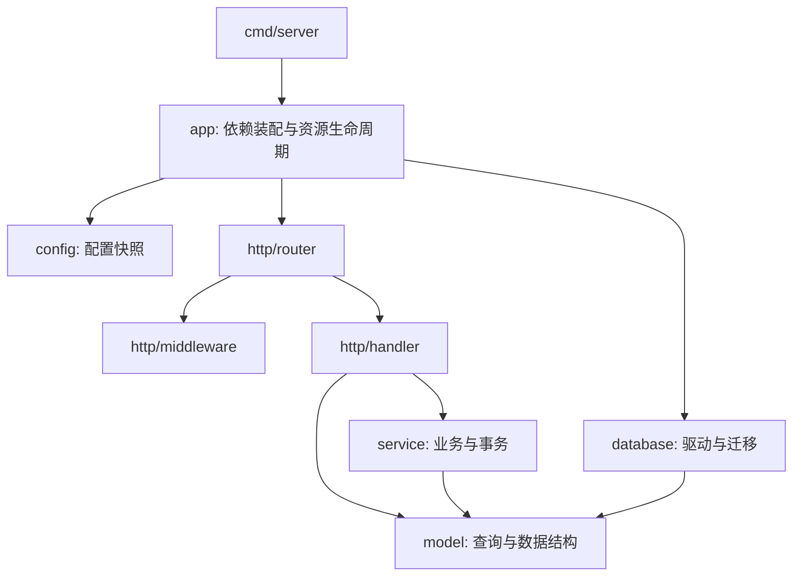

# 工程架构

## 后端

入口位于 `backend/cmd/server`，使用 `internal/` 限制应用内部包的可见范围。启动流程为读取配置 → 创建日志和会话密钥 → 连接数据库 → 迁移与必要初始化 → 装配服务与处理器 → 注册路由 → 监听 HTTP。



| 层                | 职责                                                                   | 约定                                       |
| ----------------- | ---------------------------------------------------------------------- | ------------------------------------------ |
| `cmd/server`      | 启动 HTTP、接收退出信号、优雅停服                                      | 不包含业务路由或数据规则                   |
| `app`             | 创建并注入数据库、日志、处理器和服务；统一关闭资源                     | `App.New` 产生独立实例，支持同进程隔离测试 |
| `config`          | 一次读取环境变量，构造配置值                                           | 下游通过参数获取配置，不直接读取进程环境   |
| `database`        | 分离 SQLite/MySQL/PostgreSQL 驱动、表迁移和默认管理员初始化            | 不创建演示业务数据，保留已有配置           |
| `http/router`     | 声明路由与鉴权边界、静态前端回退                                       | 路由保持原有 `/api` 契约                   |
| `http/middleware` | 会话校验、管理员权限、来源验证、JSON 大小限制、登录频控                | 依赖显式传入，频控状态按应用实例隔离       |
| `http/handler`    | 请求解码、参数与响应映射、简单读取查询、流式上传下载                   | 复杂写入规则委托给服务；按资源拆文件       |
| `service`         | 分类循环校验、作业引用事务、提交生命周期、外部身份校验、设置和附件存储 | 不导入 Gin；返回数据或可映射的应用错误     |
| `model`           | GORM 模型与 JSON 契约                                                  | 不依赖 HTTP 或服务包                       |
| `security`        | 密码摘要、账号输入校验、随机值                                         | 不持有数据库或 HTTP 状态                   |

直接使用 GORM 的查询与事务，不添加只转发调用的空仓储层。常见读取查询位于处理器，涉及业务约束的写入与跨资源事务位于服务。后续如需多种数据源，可在服务下方引入仓储接口。

数据库、HTTP 认证客户端、验证码和频控状态均由应用实例持有，没有包级可变数据库或客户端。附件服务持有共享写入互斥锁，提交、文件合并和删除沿用单进程一致性约束；该锁不等于分布式锁。

集成测试位于 `internal/app/*_test.go`，仅创建临时目录与临时数据库；纯映射逻辑测试位于相应服务包。资源关闭是幂等的，关闭一个应用实例不会影响其他实例。

## 前端

```text
app/
  providers/              会话与主题 providers
  route-guard.tsx         登录和管理员守卫
  router.tsx              路由定义，按页面懒加载
components/
  ui/                     shadcn/ui 基础组件
  form/                   表单字段、复选框、搜索框
  feedback/               空状态、加载态、确认弹窗
  layout/                 应用框架与导航
features/
  auth/pages/             登录注册页
  assignments/            我的作业、详情、标题分组、提交历史
  attachments/            分片上传 API 与上传组件
  categories/             分类树、筛选器、选择器、偏好
  profile/                基本资料、实名、QQ、密码各自的卡片与 hook
  admin/
    overview/             后台总览
    assignments/          列表、编辑页、描述编辑器与提交规则
    categories/           分类管理
    users/                用户列表与编辑
    attachments/          附件管理
    settings/             站点设置
hooks/                    跨业务数据加载 hook
lib/api/                  通用 HTTP 客户端与附件 URL
lib/                      日期、容量、异步操作提示等通用工具
types/                    共享 API 模型
styles/                   按关注点拆分的全局 CSS
```

- 路由页负责数据加载与页面组合，独立表单、卡片和上传行为放入对应业务组件或 hook。
- 通用组件不反向依赖后台页面。业务间复用组件使用明确路径导入，避免通过大型聚合文件牵入全部页面。
- `types/models.ts` 维护 API 类型，`lib/api/client.ts` 统一处理 JSON、Cookie 与会话过期；分片协议由附件功能模块实现。
- 统一使用 `@/` 导入应用模块。直接在 Node 中运行的分类测试仅依赖纯函数和擦除后的类型导入。
- `styles/index.css` 作为唯一样式入口，依次加载主题、基础、布局、组件、业务和最后的响应式覆盖，保留既有主题和布局。

## 新增功能与验证

后端新增规则时先判断是否涉及持久化、事务或外部 I/O，再放入对应服务；处理器只处理 HTTP 边界。注册路由时明确用户/管理员权限范围。前端在对应 `features/<domain>` 下新增页面与局部组件，并在 `app/router.tsx` 注册懒加载入口。

运行：

```bash
make format
make format-check
make test
```

格式工具和 CI 约定见根目录 README。不要提交数据目录、密钥、数据库、调试截图或预填业务数据。
